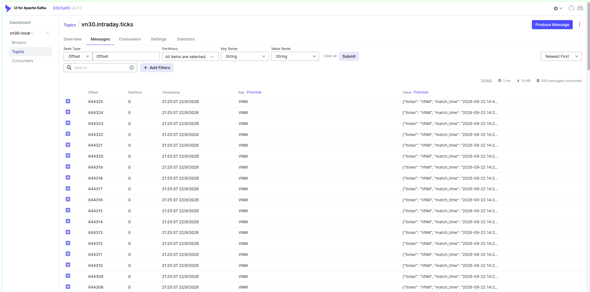
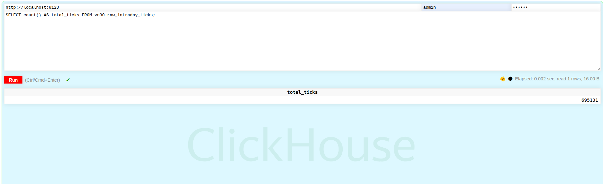
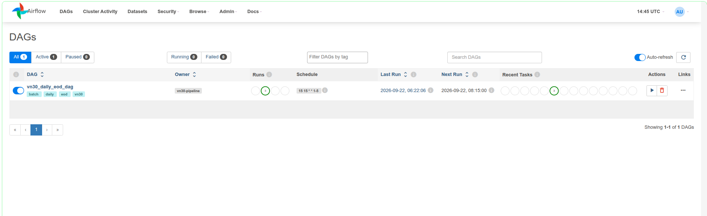
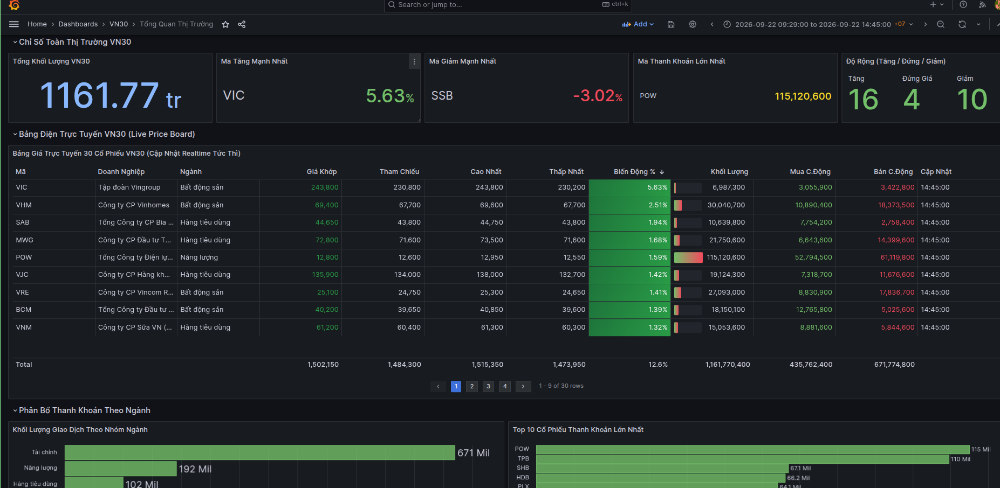
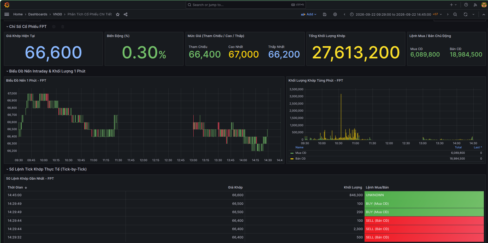

# VN30 Real-Time Stock Data Pipeline

Hệ thống thu thập, truyền phát dữ liệu theo luồng, xử lý ELT và trực quan hóa thời gian thực cho 30 mã cổ phiếu VN30 (HOSE).

---

## 1. Kiến Trúc và Luồng Dữ Liệu

Quy trình xử lý kết hợp Real-time Streaming và Scheduled Batch:

```
vnstock API (Python 3.11)
       | (Chu kỳ 15s)
       v
Apache Kafka (Topic: vn30.intraday.ticks)
       | (Kafka Table Engine)
       v
ClickHouse OLAP (Raw Data)
       | (Airflow DAG 15:15 kích hoạt dbt)
       v
dbt Transformations (Staging -> Intermediate -> Marts)
       | (HTTP Native Query)
       v
Grafana Dashboards (Bảng điện & Kỹ thuật)
```

- Ingestion: Script Python bất đồng bộ lấy dữ liệu tick khớp lệnh 30 mã cổ phiếu định kỳ 15 giây trong giờ giao dịch.
- Streaming: Đẩy dữ liệu JSON vào Kafka topic `vn30.intraday.ticks`, phân vùng theo mã cổ phiếu (ticker).
- Ingestion Engine: ClickHouse dùng Kafka Engine và Materialized View nạp tự động vào bảng `raw_intraday_ticks`.
- Transformation: dbt chuẩn hóa dữ liệu qua các tầng Staging (lọc lỗi, khử trùng), Intermediate (nến 1 phút OHLCV), Marts (bảng giá realtime).
- Orchestration: Airflow điều phối DAG cuối ngày (EOD), tổng hợp nến ngày và kiểm thử dữ liệu qua `dbt test`.
- Visualization: Grafana truy vấn trực tiếp ClickHouse hiển thị bảng giá và biểu đồ phân tích.

---

## 2. Công Nghệ Sử Dụng

| Thành phần | Công nghệ | Phiên bản | Vai trò |
|---|---|---|---|
| Thu thập dữ liệu | Python, vnstock3, aiohttp | Python 3.11, vnstock3 0.3.0, aiohttp 3.9.0 | Thu thập tick khớp lệnh thời gian thực |
| Message Broker | Apache Kafka | 7.6.0 (Confluent) | Lưu đệm streaming chế độ KRaft (không ZooKeeper) |
| Quản lý Kafka | Kafka UI | 0.7.2 (Provectus) | Giám sát topic, message payload và consumer group |
| Kho dữ liệu OLAP | ClickHouse | 24.3-alpine | Lưu trữ Time-Series, Kafka Engine, Materialized View |
| Metadata Database | PostgreSQL | 15-alpine | Lưu trữ trạng thái và lịch trình Apache Airflow |
| Biến đổi dữ liệu | dbt-core, dbt-clickhouse | 1.8.0 | Xây dựng mô hình Staging, Intermediate, Marts |
| Điều phối quy trình | Apache Airflow | 2.8.1 (LocalExecutor) | Lập lịch EOD batch, kích hoạt dbt và kiểm thử |
| Trực quan hóa | Grafana | 10.3.1 | Bảng giá điện tử và biểu đồ nến kỹ thuật |
| Môi trường | Docker, Docker Compose | v2 | Đóng gói và cô lập toàn bộ dịch vụ |

---

## 3. Báo Cáo Kết Quả Thực Nghiệm Qua Hình Ảnh

### 3.1. Kết Quả Streaming Trên Apache Kafka

Topic `vn30.intraday.ticks` tiếp nhận dữ liệu liên tục, phân vùng theo mã cổ phiếu với định dạng JSON chuẩn.



Kết quả ghi nhận:
- Cụm `vn30-local` vận hành ổn định không phát sinh consumer lag.
- Dữ liệu mã `VNM` được ghi nhận theo thời gian thực tại partition 0 với offset tăng dần liên tục.
- Mỗi bản ghi chứa đủ: ticker, match_time, price, volume, action.

### 3.2. Kết Quả Lưu Trữ Và Truy Vấn Dữ Liệu Trên ClickHouse

Bảng `raw_intraday_ticks` lưu trữ toàn bộ dữ liệu tick thông qua Materialized View tự động.



Kết quả ghi nhận:
- Tổng số bản ghi tick thu thập thành công: 695,131 bản ghi.
- Thời gian thực thi truy vấn đếm: 0.002 giây, quét 16 bytes dữ liệu.

### 3.3. Kết Quả Điều Phối Tự Động Hóa Trên Apache Airflow

DAG `vn30_daily_eod_dag` lên lịch lúc 15:15 từ Thứ Hai đến Thứ Sáu, quản lý chuỗi tác vụ: `aggregate_daily_ohlcv` -> `dbt_run` -> `dbt_test`.



Kết quả ghi nhận:
- DAG kích hoạt tự động theo cron `15 15 * * 1-5`.
- Toàn bộ các phiên chạy gần nhất đạt trạng thái thành công 100% (xanh lá cây), không có lỗi gián đoạn.

### 3.4. Kết Quả Trực Quan Hóa: Bảng Giá Và Tổng Quan Thị Trường (Grafana)

Bảng điều khiển tổng quan cung cấp chỉ số thị trường, bảng điện realtime và phân bổ dòng tiền theo ngành.



Kết quả ghi nhận:
- Tổng khối lượng khớp lệnh toàn rổ VN30: 1,161.77 triệu cổ phiếu.
- Thống kê độ rộng thị trường: 16 mã tăng, 4 mã đứng giá, 10 mã giảm.
- Mã tăng mạnh nhất: VIC (+5.63%); Mã giảm mạnh nhất: SSB (-3.02%); Thanh khoản cao nhất: POW (115 triệu cổ phiếu).
- Dòng tiền tập trung lớn nhất vào nhóm ngành Tài chính (671 triệu) và Năng lượng (192 triệu).

### 3.5. Kết Quả Trực Quan Hóa: Phân Tích Cổ Phiếu Chi Tiết (Grafana)

Bảng điều khiển chi tiết hỗ trợ theo dõi từng mã cổ phiếu (ví dụ: FPT) với biểu đồ nến 1 phút và sổ lệnh tick-by-tick.



Kết quả ghi nhận:
- Giá khớp hiện tại: 66,600 VND (+0.30% so với tham chiếu 66,400 VND).
- Tổng khối lượng khớp: 27,613,200 cổ phiếu (Bán chủ động chiếm 18.98 triệu, Mua chủ động chiếm 6.08 triệu).
- Biểu đồ nến OHLCV 1 phút và danh sách 50 lệnh khớp gần nhất hiển thị chi tiết biến động theo từng giây.

---

## 4. Mô Hình Dữ Liệu dbt

| Tầng dữ liệu | Đối tượng | Kiểu | Mô tả và logic xử lý |
|---|---|---|---|
| Ingestion | `raw_intraday_ticks` | Table (MergeTree) | Dữ liệu gốc từ Kafka, partition theo ngày, TTL 90 ngày |
| Staging | `stg_intraday_ticks` | View | Lọc `price > 0 AND volume > 0`, khử trùng lặp qua `ROW_NUMBER()` |
| Intermediate | `int_ohlcv_1min` | Table (ReplacingMergeTree) | Nến 1 phút: Open (`argMin`), High (`max`), Low (`min`), Close (`argMax`), Khối lượng mua/bán chủ động (`sumIf`) |
| Marts | `mart_vn30_price_board` | Table (ReplacingMergeTree) | Bảng giá phục vụ dashboard: tính `change_pct`, join `dim_stocks` lấy tên công ty và ngành |

---

## 5. Cấu Trúc Thư Mục Dự Án

```
VN30/
├── dags/
│   └── vn30_daily_eod_dag.py        # Airflow DAG điều phối EOD và dbt
├── img/                             # Ảnh chụp kết quả hệ thống
│   ├── airflow.png
│   ├── clickhouse.png
│   ├── grafana-dash-1.png
│   ├── grafana-dash-2.png
│   └── kafka-ui.png
├── infra/
│   ├── clickhouse/                  # Schema khởi tạo và dữ liệu seed
│   └── grafana/                     # Provisioning datasource và dashboards
├── src/
│   ├── config.py                    # Cấu hình Pydantic
│   ├── db/                          # Kết nối ClickHouse
│   ├── extractors/                  # Thu thập tick và tổng hợp EOD
│   └── producers/                   # Producer Kafka
├── transform/                       # Dự án dbt-clickhouse
│   ├── dbt_project.yml
│   └── models/                      # Models staging, intermediate, marts
├── docker-compose.yml               # Cấu hình 7 dịch vụ container
└── requirements.txt                 # Thư viện Python
```

---

## 6. Cài Đặt Và Vận Hành

### 6.1. Khởi động hệ thống

```bash
# 1. Tạo file cấu hình
cp .env.example .env

# 2. Khởi chạy toàn bộ dịch vụ
docker compose up -d

# 3. Kiểm tra trạng thái
docker compose ps
```

### 6.2. Cổng truy cập dịch vụ

| Dịch vụ | Địa chỉ | Tài khoản mặc định |
|---|---|---|
| Grafana | http://localhost:3000 | `admin` / `admin123` |
| Airflow Webserver | http://localhost:8088 | `admin` / `admin` |
| Kafka UI | http://localhost:8090 | Không yêu cầu |
| ClickHouse HTTP | http://localhost:8123 | `vn30_user` / `changeme` |
| ClickHouse Native | localhost:9000 | `vn30_user` / `changeme` |

### 6.3. Lệnh kiểm tra thường dùng

```bash
# Thực thi và kiểm thử dbt
cd transform && dbt run --profiles-dir . && dbt test --profiles-dir .

# Kiểm tra số lượng bản ghi trong ClickHouse
docker exec -it vn30_clickhouse clickhouse-client -u vn30_user --password changeme --database vn30 --query "
SELECT 'raw_intraday_ticks' AS bang, count() AS so_ban_ghi FROM raw_intraday_ticks
UNION ALL
SELECT 'int_ohlcv_1min' AS bang, count() AS so_ban_ghi FROM int_ohlcv_1min
UNION ALL
SELECT 'mart_vn30_price_board' AS bang, count() AS so_ban_ghi FROM mart_vn30_price_board;
"
```

---

## 7. Giấy Phép (License)

Dự án phát hành theo giấy phép MIT.
